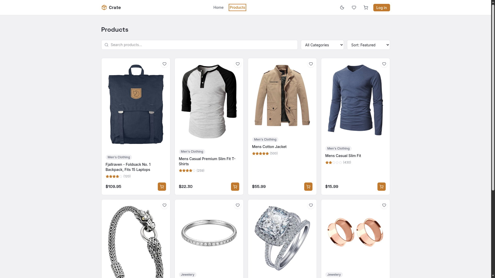

# Crate 📦

Crate is a simple online store built with **React 19** and **Vite**. It shows products from a public API, and lets users search, filter, add to cart, save a wishlist, and manage personal notes from a dashboard.

There is no backend. Product data comes from [Fake Store API](https://fakestoreapi.com), and everything else (users, cart, wishlist, notes, theme) is saved in the browser's `localStorage`.



## Features

- **Products page** with search (debounced), category filter, sorting (price / rating) and pagination
- **Product details page** with quantity selector and related products
- **Cart drawer** with add, remove, change quantity and total price
- **Wishlist** (heart icon on every product)
- **Login and Register** (stored in localStorage, no real server)
- **Protected dashboard** with stats, a notes manager (add, edit, delete, mark done) and an editable profile with avatar upload
- **Dark / light theme** toggle
- **Toast notifications**, loading spinners and error boundaries
- **Route-level code splitting** using `React.lazy`
- Home page with FAQ section

## Tech Stack

| Purpose | Tool |
| --- | --- |
| UI library | React 19 |
| Build tool | Vite |
| Routing | React Router v7 |
| Styling | Tailwind CSS v4 |
| API calls | Axios |
| Icons | Lucide React |
| Linting | ESLint |

## Getting Started

**Requirements:** Node.js 18 or higher

```bash
# 1. Go into the project folder
cd "Final Project"

# 2. Install dependencies
npm install

# 3. Start the dev server
npm run dev
```

Open the link shown in the terminal (usually `http://localhost:5173`).

### Other scripts

| Command | What it does |
| --- | --- |
| `npm run dev` | Starts the development server |
| `npm run build` | Creates a production build in `dist/` |
| `npm run preview` | Previews the production build |
| `npm run lint` | Runs ESLint |

## Project Structure

```
src/
├── api/          # Axios instance (base URL, error logging)
├── components/
│   ├── cart/       # CartDrawer, CartItem, CartSummary
│   ├── common/     # Button, Input, Badge, Spinner, RatingStars, EmptyState
│   ├── layout/     # MainLayout, AuthLayout, DashboardLayout, Navbar, Footer
│   ├── notes/      # NoteForm, NoteItem, NoteList
│   ├── products/   # ProductCard, ProductGrid, ProductFilters, SearchBar, Pagination
│   └── ui/         # Modal, Dropdown, ConfirmDialog, ToastContainer, AsyncBoundary
├── context/      # Auth, Cart, Wishlist, Theme, Toast providers
├── data/         # faqs.json
├── hooks/        # useFetch, useDebounce, useForm, useLocalStorage, usePagination, ...
├── pages/        # Home, Products, ProductDetails, Login, Register, Wishlist, Dashboard, Notes, Profile, NotFound
├── routes/       # AppRoutes, ProtectedRoute, PublicRoute
└── utils/        # constants, formatters, validators, cn
```

## Routes

| Path | Page | Access |
| --- | --- | --- |
| `/` | Home | Everyone |
| `/products` | Products list | Everyone |
| `/products/:id` | Product details | Everyone |
| `/login`, `/register` | Auth pages | Only when logged out |
| `/wishlist` | Wishlist | Logged in |
| `/dashboard` | Dashboard overview | Logged in |
| `/dashboard/notes` | Notes | Logged in |
| `/dashboard/profile` | Profile | Logged in |
| `*` | 404 page | Everyone |

## Concepts Used

- Context API for global state (auth, cart, wishlist, theme, toasts)
- `useReducer` for cart and notes
- Custom hooks (`useFetch`, `useDebounce`, `useLocalStorage`, `useForm`, `usePagination`)
- Protected and public routes with nested layouts
- URL search params as the source of truth for filters and sorting
- Error boundaries (app level and widget level)
- `useMemo` / `useCallback` for performance
- Lazy loading of pages

## Notes

- This is a demo project. Passwords are saved as plain text in `localStorage`, so do not use real passwords.
- Checkout is not implemented.
- Clearing your browser data will remove the saved users, cart, wishlist and notes.
